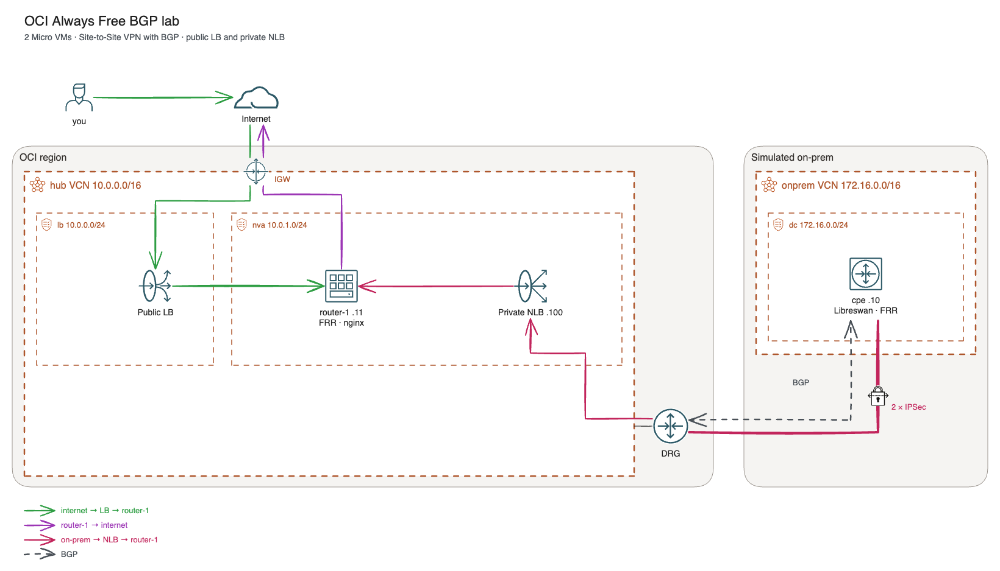
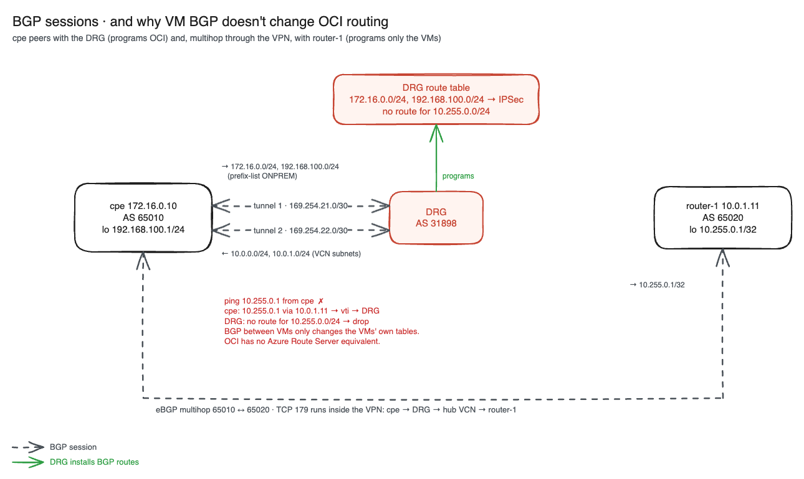

# OCI Always Free BGP lab

A BGP and hybrid-networking lab on Oracle Cloud that stays inside the [Always Free](https://www.oracle.com/cloud/free/) limits and uses only the two E2.1.Micro VMs, so it never waits for Ampere A1 capacity. A simulated on-prem data centre (the CPE VM) connects to a hub VCN over a Site-to-Site VPN with BGP, and peers with a hub router VM over eBGP multihop across that VPN. The router serves a web page behind a private Network Load Balancer (for on-prem) and a public Load Balancer (for the internet). The [Azure mapping](#azure-mapping) and [AWS mapping](#aws-mapping) sections list the equivalents.

Everything is vendor-neutral: Ubuntu 24.04, FRR, Libreswan, nginx and iptables. Nothing here needs a licence.

A [series of articles](#articles) walks through the lab layer by layer, with hands-on exercises.

## Articles

The exercises live in a series of articles, one per layer of the lab:

1. [A free hybrid-networking lab on Oracle Cloud](docs/articles/01-free-oci-hybrid-lab.md): what gets built, the Always Free limits, design notes, deploy
2. [Site-to-Site VPN with Libreswan: route-based IPSec to a DRG](docs/articles/02-site-to-site-vpn-libreswan.md): two tunnels, VTIs, NAT-T, the iptables rule that blocks BGP
3. [BGP hands-on: eBGP between on-prem and the cloud](docs/articles/03-bgp-hands-on.md): sessions, RFC 8212 policy, AS path, prepending, local-preference, maximum-prefix; all the BGP exercises
4. [DRG routing and the missing Route Server](docs/articles/04-drg-routing-no-route-server.md): DRG route tables, ingress routing, making router-1's loopback reachable
5. [Load balancers in a hybrid setup: public LB vs private NLB](docs/articles/05-load-balancers-hybrid.md): full proxy vs L4, source IPs, flow logs, health checks

## Topology



*Editable source: [`topology.excalidraw.svg`](diagrams/topology.excalidraw.svg) (open in Excalidraw).*

**Route tables**

| Where | Destination | Next hop | Why |
|---|---|---|---|
| `lb` subnet | 0.0.0.0/0 | Internet gateway | public LB |
| `nva` subnet | 0.0.0.0/0 | Internet gateway | router-1's own traffic (packages, SSH) |
| `nva` subnet | 172.16.0.0/16, 192.168.100.0/24 | DRG | router-1 and the NLB → on-prem |
| DRG attachment (VCN ingress) | *(empty)* | | attached but without rules: the hook for the exercise in [article 4](docs/articles/04-drg-routing-no-route-server.md) |
| DRG (auto, BGP) | 172.16.0.0/24, 192.168.100.0/24 | IPSec tunnels | learned from the CPE |

**Not covered on Always Free Micro:** an NVA *in the path*: a router pair behind a transparent NLB with ingress routing and UDR-style route rules. That needs two more VMs, and therefore Ampere A1 capacity. See [Learn About Deploying Palo Alto firewall in Active/Active mode with OCI Flexible Network Load Balancer](https://docs.oracle.com/en/solutions/oci-nlb-palo-alto-active-active/index.html) for that pattern.

## Packet flows

**On-prem → web** (`curl http://10.0.1.100` from the CPE):
1. The CPE has learned the hub subnets 10.0.0.0/24 and 10.0.1.0/24 by BGP from both tunnels, so the packet leaves through `vti1` or `vti2`. The source is 172.16.0.10, because the `SET-SRC` route-map stops Linux from using the 169.254 tunnel address.
2. The OCI VPN headend decrypts the packet and the DRG forwards it to the hub VCN attachment. The attachment's ingress route table is empty, so the packet goes straight to the NLB's subnet.
3. The NLB sends the connection to router-1:80. Source preservation is off, so router-1 sees the NLB's IP (10.0.1.100) as the client, and its reply goes back to the NLB.
4. The NLB reverses the translation and sends the reply to 172.16.0.10: `nva` route → DRG → tunnel → CPE.

**Internet → web** (`curl <app_url>`): the public LB (a full proxy) opens a new connection from its own private IP in `lb` to 10.0.1.11:80. The reply goes back to the LB inside the VCN.

**router-1 → internet**: the `nva` route 0.0.0.0/0 → internet gateway, which maps router-1's private IP to its public IP. No NAT gateway is needed.

## BGP sessions

| Session | Type | Path | What is exchanged |
|---|---|---|---|
| CPE ↔ DRG, ×2 | eBGP 65010 ↔ 31898 over VTI | inside each IPSec tunnel | The CPE advertises 172.16.0.0/24 and 192.168.100.0/24 (prefix-list `ONPREM`). The DRG advertises the hub VCN's subnets (10.0.0.0/24, 10.0.1.0/24), not the VCN CIDR. Every session has an `in` and an `out` route-map (see [article 3](docs/articles/03-bgp-hands-on.md)). |
| CPE ↔ router-1 | eBGP multihop 65010 ↔ 65020 | across the VPN, TCP 179 | router-1 advertises its loopback 10.255.0.1/32. The CPE advertises the on-prem prefixes. |



*Editable source: [`bgp-sessions.excalidraw.svg`](diagrams/bgp-sessions.excalidraw.svg) (open in Excalidraw).*

The second session holds the **key lesson**, which is the same one as in Azure. BGP between VMs only changes the VMs' own routing tables. The CPE learns 10.255.0.1/32, but a ping to it fails: the packet goes into the tunnel, and the DRG has no route for 10.255.0.0/24 because nothing advertised it to OCI. OCI has no equivalent of Azure Route Server or AWS VPC Route Server, so a VM can't program the VCN or DRG with BGP. Only the DRG's own sessions over IPSec or FastConnect do that. [Article 3](docs/articles/03-bgp-hands-on.md) walks through the sessions, and [article 4](docs/articles/04-drg-routing-no-route-server.md) makes the loopback reachable with static routes.

## Always Free usage

| Resource | Used | Always Free limit |
|---|---|---|
| E2.1.Micro | cpe, router-1 | 2 |
| Ampere A1 | **not used** (often "Out of host capacity") | 2 OCPU, 12 GB in total |
| Boot volumes | 2 × 50 GB | 200 GB |
| VCNs | hub, onprem | 2 (Free Tier accounts) |
| Flexible Load Balancer | 1, 10 Mbps | 1 |
| Network Load Balancer | 1 | 1 |
| Site-to-Site VPN | 1 connection, 2 IPSec tunnels | 50 IPSec connections |
| DRG | 1 | Oracle lists no charge for DRG |
| Public IPs | 2 ephemeral (cpe, router-1) | ephemeral IPs on Always Free VMs |
| Flow logs | `nva` subnet | 10 GB/month |
| NAT gateway | **not used** | n/a |

Sources: [Always Free Resources](https://docs.oracle.com/en-us/iaas/Content/FreeTier/freetier_topic-Always_Free_Resources.htm) · [Dynamic Routing Gateway](https://www.oracle.com/cloud/networking/dynamic-routing-gateway/) · [VCN pricing](https://www.oracle.com/cloud/networking/virtual-cloud-network/pricing/)

> ⚠️ **Check after the first apply.** On a Pay-As-You-Go account, anything over the limits above is billed. Look at *Billing → Cost Analysis* the next day, and set a budget alert (for example $1) beforehand. Oracle can reclaim Always Free VMs that stay idle for 7 days, so destroy the lab between sessions.

## Deploy

Prerequisites: an OCI account (the profile's region must be the tenancy's home region), `~/.oci/config` with an API key, Terraform ≥ 1.5, and an SSH key pair. Terraform SSHes to the CPE VM to push the VPN config, so it uses `ssh_private_key_path`. The SSH rules allow only your current public IP, which Terraform reads from `https://ifconfig.me/ip` on every plan.

**Authenticate** (once). The provider reads the `DEFAULT` profile in `~/.oci/config` (`config_file_profile`):

```bash
brew install oci-cli
oci setup config                               # user OCID, tenancy OCID, home region; Y to generate a key pair
cat ~/.oci/oci_api_key_public.pem              # Console → My profile → API keys → Add API key → Paste a public key
oci iam availability-domain list               # test: lists your ADs
```

The user OCID is under *avatar → My profile*, the tenancy OCID under *avatar → Tenancy*. The fingerprint the console shows after the upload must match `fingerprint=` in `~/.oci/config`. Without the CLI, *Add API key → Generate API key pair* downloads the private key and shows a config snippet to paste into `~/.oci/config` (point `key_file=` at the `.pem`). See [Required Keys and OCIDs](https://docs.oracle.com/en-us/iaas/Content/API/Concepts/apisigningkey.htm).

**Find your Micro AD.** In multi-AD regions, Always Free E2.1.Micro VMs work in one availability domain only; elsewhere the limit is 0 and the launch fails with `400-LimitExceeded`. Set `micro_ad_index` to the 0-based position of the AD with value 2:

```bash
oci limits value list --service-name compute --name vm-standard-e2-1-micro-count --all \
  --compartment-id "$(awk -F= '/^tenancy/{print $2}' ~/.oci/config)"
```

**Deploy:**

```bash
cp terraform.tfvars.example terraform.tfvars   # set compartment_id (= tenancy OCID) and micro_ad_index
terraform init
terraform plan
terraform apply                                # ~10-15 min, mostly the VPN and cloud-init
terraform output
```

## Test

```bash
# CPE: tunnels and BGP
ssh ubuntu@<cpe>
sudo ipsec trafficstatus                     # both tunnels with traffic counters
sudo vtysh -c "show bgp summary"             # 2 OCI peers + router-1 Established
sudo vtysh -c "show ip route bgp"            # 10.0.0.0/24, 10.0.1.0/24 via vti1 and vti2 (ECMP), 10.255.0.1/32
curl -s http://10.0.1.100                    # on-prem → NLB → nginx on router-1
curl -s --interface 192.168.100.1 http://10.0.1.100   # from the on-prem "LAN"
ping -c3 10.0.1.11                           # on-prem → router-1 directly
ping -c3 10.255.0.1                          # fails: see "BGP sessions" above and article 4

# router-1
ssh ubuntu@<router-1>
sudo vtysh -c "show bgp summary"             # the CPE Established
sudo vtysh -c "show ip route bgp"            # 192.168.100.0/24 via 172.16.0.10; 172.16.0.0/24 "inactive" (its next hop is inside it)
sudo tcpdump -ni any port 80                 # curl from the CPE: the client is 10.0.1.100 (the NLB)

# From your Mac
curl http://<lb-ip>                          # app_url output
```

In the OCI console, *Networking → Site-to-Site VPN → tunnels* shows the IPSec and BGP status. *DRG → DRG route tables → Get all route rules* shows the BGP-learned on-prem routes.

## Destroy

```bash
terraform destroy
```

## Azure mapping

| This lab (OCI) | Azure equivalent |
|---|---|
| DRG + Site-to-Site VPN, BGP | VPN Gateway (active-active) + Local Network Gateway, BGP |
| VCN ingress route table on the DRG attachment | UDR on GatewaySubnet |
| Private NLB (TCP 80 VIP) | Internal Standard Load Balancer |
| Public flexible Load Balancer | Public Standard Load Balancer (or Application Gateway for L7) |
| Security lists | NSGs |
| No equivalent | Azure Route Server (NVA ↔ fabric BGP) |

* [About active-active mode VPN gateways](https://learn.microsoft.com/en-us/azure/vpn-gateway/about-active-active-gateways): two gateway instances, two tunnels and two BGP peers, like the two OCI tunnels
* [About BGP and VPN Gateway](https://learn.microsoft.com/en-us/azure/vpn-gateway/vpn-gateway-bgp-overview): BGP over S2S VPN, ASN 65515, APIPA peer addresses
* [Modify local network gateway settings using the Azure portal](https://learn.microsoft.com/en-us/azure/vpn-gateway/vpn-gateway-modify-local-network-gateway-portal): the on-prem side (OCI CPE object)
* [About VPN Gateway configuration settings](https://learn.microsoft.com/en-us/azure/vpn-gateway/vpn-gateway-about-vpn-gateway-settings#gwsub): GatewaySubnet rules (UDRs allowed, but no 0.0.0.0/0 and no NSG)
* [Azure virtual network traffic routing](https://learn.microsoft.com/en-us/azure/virtual-network/virtual-networks-udr-overview): UDRs and the *Virtual appliance* next hop
* [What is Azure Load Balancer?](https://learn.microsoft.com/en-us/azure/load-balancer/load-balancer-overview): internal and public Standard Load Balancer
* [Azure network security groups overview](https://learn.microsoft.com/en-us/azure/virtual-network/network-security-groups-overview): stateful rules on subnets and NICs
* [What is Azure Route Server?](https://learn.microsoft.com/en-us/azure/route-server/overview): BGP between NVAs and the VNet, which OCI doesn't have

## AWS mapping

| This lab (OCI) | AWS equivalent |
|---|---|
| DRG + Site-to-Site VPN, BGP | Virtual private gateway or Transit Gateway + Customer gateway + Site-to-Site VPN (two tunnels), BGP |
| VCN ingress route table on the DRG attachment | Gateway route table with an edge association to the virtual private gateway (ingress routing) |
| Private NLB (TCP 80 VIP) | Internal Network Load Balancer |
| Public flexible Load Balancer | Application Load Balancer |
| Security lists (subnet scope, stateful) | Security groups (stateful); network ACLs are subnet scope but stateless |
| No equivalent | VPC Route Server (NVA ↔ VPC route table BGP), or Transit Gateway Connect (GRE + BGP to the TGW) |

* [How AWS Site-to-Site VPN works](https://docs.aws.amazon.com/vpn/latest/s2svpn/how_it_works.html): virtual private gateway, Transit Gateway and customer gateway
* [Tunnel options for your AWS Site-to-Site VPN connection](https://docs.aws.amazon.com/vpn/latest/s2svpn/VPNTunnels.html): two tunnels per connection, inside CIDRs (169.254.x.x/30), IKE settings
* [AWS Site-to-Site VPN customer gateway devices](https://docs.aws.amazon.com/vpn/latest/s2svpn/your-cgw.html): what the CPE has to do, including BGP
* [AWS Site-to-Site VPN attachments in AWS Transit Gateway](https://docs.aws.amazon.com/vpc/latest/tgw/tgw-vpn-attachments.html): VPN terminated on a TGW instead of a VGW
* [Gateway route tables](https://docs.aws.amazon.com/vpc/latest/userguide/gateway-route-tables.html): ingress routing on the virtual private gateway, the DRG attachment ingress route table equivalent
* [What is a Network Load Balancer?](https://docs.aws.amazon.com/elasticloadbalancing/latest/network/introduction.html): the internal L4 load balancer, like the OCI NLB here
* [What is an Application Load Balancer?](https://docs.aws.amazon.com/elasticloadbalancing/latest/application/introduction.html): the full-proxy HTTP LB, like the OCI public LB
* [Control traffic to your AWS resources using security groups](https://docs.aws.amazon.com/vpc/latest/userguide/vpc-security-groups.html): stateful, per ENI
* [Control subnet traffic with network access control lists](https://docs.aws.amazon.com/vpc/latest/userguide/vpc-network-acls.html): stateless, per subnet
* [Dynamic routing in your VPC using VPC Route Server](https://docs.aws.amazon.com/vpc/latest/userguide/dynamic-routing-route-server.html): BGP from appliances into VPC route tables, which OCI doesn't have
* [Connect attachments and Connect peers in AWS Transit Gateway](https://docs.aws.amazon.com/vpc/latest/tgw/tgw-connect.html): GRE + BGP between an appliance and a Transit Gateway

## Files

- `network.tf`: VCNs, subnets, route tables, security lists, flow logs
- `vpn.tf`: DRG, CPE, IPSec connection, tunnels (BGP, IKEv2), and the SSH push of the CPE config
- `compute.tf`: the 2 Micro VMs (cpe, router-1)
- `load_balancers.tf`: the private NLB and the public LB, both in front of nginx on router-1
- `templates/`: cloud-init for each VM, plus the Libreswan and FRR config templates for the CPE
- `docs/articles/`: the article series with the exercises
- `diagrams/`: Excalidraw diagrams (`.excalidraw.svg` is the editable source, `.png` is embedded in the README and the articles). They are generated by `tools/diagrams/build.py`: `cd tools/diagrams && npm install && npm run build`. The build downloads Oracle's [OCI Architecture Diagram Toolkits](https://docs.oracle.com/en-us/iaas/Content/General/Reference/graphicsfordiagrams.htm) once and extracts the official icons into `tools/diagrams/.cache/` (not committed)

## References

* [Oracle Cloud Free Tier](https://www.oracle.com/cloud/free/): sign-up and what Always Free and the 30-day trial include
* [Always Free Resources](https://docs.oracle.com/en-us/iaas/Content/FreeTier/freetier_topic-Always_Free_Resources.htm): limits for compute, storage and networking
* [Site-to-Site VPN Overview](https://docs.oracle.com/en-us/iaas/Content/Network/Tasks/overviewIPsec.htm): tunnels, CPE object, BGP or static routing
* [Dynamic Routing Gateways](https://docs.oracle.com/en-us/iaas/Content/Network/Tasks/managingDRGs.htm): DRG attachments, DRG route tables and import distributions
* [Libreswan CPE configuration](https://docs.oracle.com/en-us/iaas/Content/Network/Reference/libreswanCPE.htm): the route-based VTI config this lab is based on
* [VPN Connection to Google](https://docs.oracle.com/en-us/iaas/Content/Network/Tasks/vpn_to_gcp.htm): lists the 169.254.x.x ranges OCI rejects as inside-tunnel IPs
* [VCN Route Tables](https://docs.oracle.com/en-us/iaas/Content/Network/Tasks/managingroutetables.htm#Route): private IP as a route target
* [Security Lists](https://docs.oracle.com/en-us/iaas/Content/Network/Concepts/securitylists.htm): stateful and stateless subnet rules
* [Overview of Load Balancer](https://docs.oracle.com/en-us/iaas/Content/Balance/Concepts/balanceoverview.htm): the public flexible LB
* [Learn About Deploying Palo Alto firewall in Active/Active mode with OCI Flexible Network Load Balancer](https://docs.oracle.com/en/solutions/oci-nlb-palo-alto-active-active/index.html): the NVA-in-the-path pattern this lab doesn't build on Micro VMs
