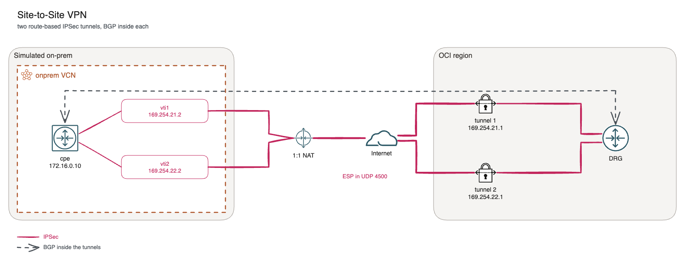

# Site-to-Site VPN with Libreswan: route-based IPSec to a DRG

*Part 2 of 6 in the OCI Always Free BGP lab series. Previous: [A free hybrid-networking lab on Oracle Cloud](01-free-oci-hybrid-lab.md). Next: [BGP sessions and policy](03-bgp-sessions-and-policy.md).*

Before BGP can run between on-prem and the cloud, there has to be a path for it. In this lab that path is an OCI Site-to-Site VPN: two IPSec tunnels between a Linux VM running Libreswan (the "cpe") and the DRG. This article looks at how those tunnels are built and what to check when they don't come up.

## Two tunnels, two headends



OCI always gives a Site-to-Site VPN connection two tunnels, each to a different headend. Both are active, and the CPE is expected to run both. Azure's active-active VPN gateway and AWS Site-to-Site VPN work the same way.

## The OCI side

Three resources in `vpn.tf` make up the OCI side:

- **`oci_core_cpe`**: a record of the on-prem device. Its IP is the **public** IP of the cpe VM.
- **`oci_core_ipsec`**: the connection between that CPE and the DRG. OCI creates both tunnels with it.
- **`oci_core_ipsec_connection_tunnel_management`** (one per tunnel): switches the tunnel to BGP, IKEv2 and a pre-shared key, and pins the crypto:

| | Phase 1 (IKE) | Phase 2 (IPSec) |
|---|---|---|
| Encryption | AES-256-CBC | AES-256-GCM |
| Integrity | SHA2-384 | (part of GCM) |
| DH group | 14 | 14, with PFS |
| Lifetime | 8 h | 1 h |

Pinning the algorithms on both sides avoids a common failure: the two ends propose overlapping but different sets, and negotiation picks something one side then rejects.

Each tunnel also gets a pair of **inside addresses**: a /30 for BGP inside the tunnel, 169.254.21.0/30 for tunnel 1 and 169.254.22.0/30 for tunnel 2. OCI takes the `.1`, the cpe the `.2`. Not every 169.254.x.x range is accepted: OCI rejects 169.254.10-19.x, 169.254.100-109.x and 169.254.192-201.x.

## The Libreswan side

Oracle documents a route-based Libreswan setup, and `templates/cpe-ipsec.conf.tftpl` follows it. Per tunnel:

```
conn oci-tunnel-1
    left=172.16.0.10              # the VM's private IP
    leftid=<cpe public IP>        # what OCI knows the CPE as
    right=<tunnel 1 headend>
    leftsubnet=0.0.0.0/0
    rightsubnet=0.0.0.0/0
    mark=5/0xffffffff
    vti-interface=vti1
    vti-routing=no
    leftvti=169.254.21.2/30
    ikev2=insist
    encapsulation=yes
```

The important parts:

- **Route-based, not policy-based.** `leftsubnet=0.0.0.0/0` and `rightsubnet=0.0.0.0/0` let any traffic into the tunnel, and routing decides what goes in: whatever the kernel routes to `vti1` is encrypted into tunnel 1. The `mark` ties the tunnel to its VTI interface.
- **`vti-routing=no`.** Libreswan doesn't add routes. FRR adds them from BGP, so the routes follow whichever tunnels are up.
- **NAT.** The VM has only a private IP; OCI maps it 1:1 to its public IP. So `left` is the private IP, `leftid` the public IP, and `encapsulation=yes` forces NAT-T. IKE starts on UDP 500 and moves to UDP 4500, and ESP travels inside UDP 4500. The security list on the cpe's subnet allows UDP 500 and 4500 in.

The cloud-init for the cpe also sets `net.ipv4.ip_forward = 1` and turns off `rp_filter`. With two tunnels and ECMP, a reply can come back on the other tunnel, and strict reverse-path filtering would drop it.

## The firewall rule that blocks BGP

Oracle's Ubuntu images have an iptables chain called `InstanceServices`. The `OUTPUT` chain jumps to it, and it rejects TCP and UDP to 169.254.0.0/16 except for a few allowed metadata ports. The purpose is to protect the metadata service at 169.254.169.254.

The BGP peers inside the tunnels are 169.254.21.1 and 169.254.22.1, so the same rule rejects BGP from the cpe to the DRG. The tunnels come up, ping works, and BGP stays in `Active`. The fix in `vpn.tf` allows output on the tunnel interfaces only, so the metadata service stays protected on `ens3`:

```bash
sudo iptables -I OUTPUT 1 -o vti+ -j ACCEPT
```

## Exercises

Run these on the cpe (`ssh ubuntu@<cpe>`). Each exercise ends with a cleanup step. The expected outputs come from the configs and the tools' documented behaviour; they have not been captured from a live run yet.

### Exercise 1: Check the tunnels

```bash
sudo ipsec status | grep -i established   # an IKE SA and a child SA per tunnel
sudo ipsec trafficstatus                  # one line per tunnel, with inBytes/outBytes
ip -s link show vti1                      # packet counters on the tunnel interface
```

Run `curl -s http://10.0.1.100` a few times and run `ipsec trafficstatus` again: the byte counters of one or both tunnels grow. In the console, *Networking → Site-to-Site VPN → (connection) → Tunnels* shows each tunnel's IPSec status and BGP status.

**Azure link:** *Connections → (connection) → Overview* shows the same status and byte counters for each connection.
**AWS link:** *Site-to-Site VPN connections → Tunnel details* shows the status of both tunnels.

### Exercise 2: Inside and outside the tunnel

Open two SSH sessions to the cpe. In the first:

```bash
sudo tcpdump -ni ens3 udp port 4500
```

In the second:

```bash
sudo tcpdump -ni vti1
```

Then run `ping -c3 10.0.1.11` in a third session. On `ens3` you see only UDP 4500 between 172.16.0.10 and the tunnel headends: encrypted ESP. On `vti1` you see the ICMP itself, plus BGP keepalives on TCP 179 between 169.254.21.2 and 169.254.21.1. The ping may also leave through `vti2`, since the cpe uses both tunnels (ECMP).

### Exercise 3: Wrong pre-shared key

Back up the secrets file and break the key for tunnel 1 (the first line):

```bash
sudo cp /etc/ipsec.d/oci-ipsec.secrets /root/oci-ipsec.secrets.bak
sudo sed -i '1s/PSK "/PSK "x/' /etc/ipsec.d/oci-ipsec.secrets
sudo ipsec auto --rereadsecrets
sudo ipsec auto --down oci-tunnel-1
sudo ipsec auto --up oci-tunnel-1
```

The `--up` fails in the IKE_AUTH exchange with `AUTHENTICATION_FAILED`. It prints pluto's progress straight to your terminal, so the error shows up there, on a line that starts with `"oci-tunnel-1" #<n>:` (the exact wording depends on the Libreswan version). Press Ctrl+C to get your prompt back. Pluto also logs to the systemd journal, so you can find the error again later, or follow it live in a second session with `-f`:

```bash
sudo journalctl -u ipsec --since "5 min ago" | grep -E "oci-tunnel-1|AUTHENTICATION_FAILED"
sudo ipsec trafficstatus   # only oci-tunnel-2 has an established IPsec SA
```

Tunnel 2 keeps carrying traffic, so `curl -s http://10.0.1.100` still works. In the console, tunnel 1 shows *Down*.

Clean up:

```bash
sudo cp /root/oci-ipsec.secrets.bak /etc/ipsec.d/oci-ipsec.secrets
sudo ipsec auto --rereadsecrets
sudo ipsec auto --up oci-tunnel-1
```

### Exercise 4: The metadata rule blocks BGP

Look at the rule chain first:

```bash
sudo iptables -L OUTPUT -n -v --line-numbers   # rule 1: ACCEPT on vti+, then the InstanceServices jump
sudo iptables -L InstanceServices -n           # the REJECT rules for 169.254.0.0/16
```

Remove the `vti+` rule and reset one BGP session. `iptables -D` deletes one matching rule per call, and the listing above may show more than one copy (for example, if you ran the command from the section above by hand). Repeat the `-D` until it prints `Bad rule (does a matching rule exist in that chain?)`; while any copy is left, BGP keeps working:

```bash
sudo iptables -D OUTPUT -o vti+ -j ACCEPT   # repeat until "Bad rule"
sudo vtysh -c "clear bgp 169.254.21.1"
sudo vtysh -c "show bgp summary"
```

The tunnels stay up, but 169.254.21.1 can't get back to Established and sits in `Connect` or `Active`: the cpe's TCP SYN to port 179 is rejected locally. The other DRG session stays Established at first. It drops only when its hold timer expires (90 to 180 seconds, depending on what the peers negotiated), because its keepalives are rejected as well, so wait about 3 minutes and run `show bgp summary` again to see it. The router-1 session stays up, because 10.0.1.11 isn't a 169.254 address.

Clean up:

```bash
sudo iptables -I OUTPUT 1 -o vti+ -j ACCEPT
sudo vtysh -c "clear bgp 169.254.21.1"
sudo vtysh -c "show bgp summary"
```

The sessions don't come back straight away. After the failed attempts, a session can stay in `Active` for a minute or two while FRR's connect-retry timer (120 seconds by default) runs out, then it returns to Established. If it is still down after about 3 minutes, check that rule 1 in `sudo iptables -L OUTPUT -n -v --line-numbers` is the `vti+` ACCEPT and that its packet counter goes up.

Terraform saved the rule with `netfilter-persistent save` when it set up the cpe, and the deletion was never saved, so a reboot would also restore it.

## Azure and AWS equivalents

| This lab (OCI) | Azure | AWS |
|---|---|---|
| CPE object | Local network gateway | Customer gateway |
| IPSec connection, 2 tunnels | Connection to an active-active VPN gateway | Site-to-Site VPN connection (always 2 tunnels) |
| Inside addresses 169.254.x.x/30 | APIPA BGP addresses (169.254.21.x-169.254.22.x) | Tunnel inside CIDR (169.254.x.x/30) |

## Links

* [Site-to-Site VPN Overview](https://docs.oracle.com/en-us/iaas/Content/Network/Tasks/overviewIPsec.htm): tunnels, CPE object, BGP or static routing
* [Libreswan CPE configuration](https://docs.oracle.com/en-us/iaas/Content/Network/Reference/libreswanCPE.htm): the route-based VTI config this lab is based on
* [VPN Connection to Google](https://docs.oracle.com/en-us/iaas/Content/Network/Tasks/vpn_to_gcp.htm): lists the 169.254.x.x ranges OCI rejects as inside-tunnel IPs
* [About active-active mode VPN gateways](https://learn.microsoft.com/en-us/azure/vpn-gateway/about-active-active-gateways): two gateway instances, two tunnels and two BGP peers, like the two OCI tunnels
* [About BGP and VPN Gateway](https://learn.microsoft.com/en-us/azure/vpn-gateway/vpn-gateway-bgp-overview): BGP over S2S VPN, ASN 65515, APIPA peer addresses
* [Tunnel options for your AWS Site-to-Site VPN connection](https://docs.aws.amazon.com/vpn/latest/s2svpn/VPNTunnels.html): two tunnels per connection, inside CIDRs (169.254.x.x/30), IKE settings
* [AWS Site-to-Site VPN customer gateway devices](https://docs.aws.amazon.com/vpn/latest/s2svpn/your-cgw.html): what the CPE has to do, including BGP
