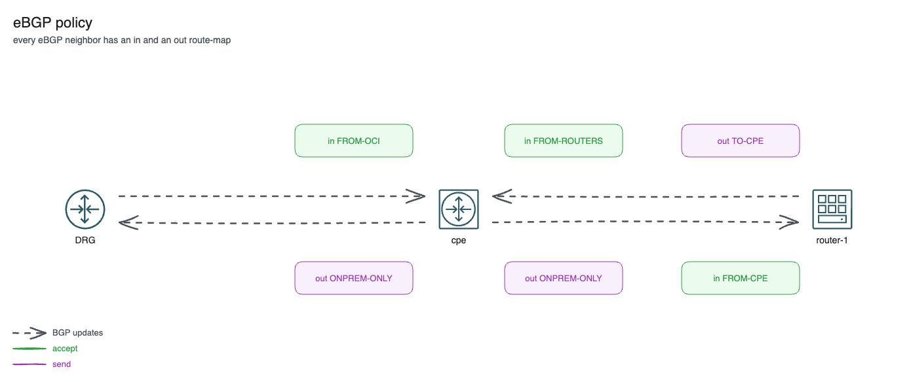

# BGP hands-on, part 1: eBGP sessions and policy

*Part 3 of 6 in the OCI Always Free BGP lab series. Previous: [Site-to-Site VPN with Libreswan](02-site-to-site-vpn-libreswan.md). Next: [BGP path selection and its limits](04-bgp-path-selection.md).*

Most hybrid designs run BGP somewhere: VPN gateways, ExpressRoute, Direct Connect, FastConnect, SD-WAN appliances. Most people configure it once from a vendor template and never see what it does. This article and the next one use the lab to look at BGP up close. This one covers the sessions and the policy every eBGP session needs. [The next one](04-bgp-path-selection.md) covers the AS path, how to steer traffic, and where BGP stops being useful in a cloud.

The exercises run on two VMs with FRR, so nothing here needs a licence.

## Three sessions


| Session | Type | What is exchanged |
|---|---|---|
| cpe ↔ DRG, ×2 | eBGP 65010 ↔ 31898, one per tunnel, peers 169.254.21.1 and 169.254.22.1 | The cpe sends 172.16.0.0/24 and 192.168.100.0/24. The DRG sends the hub VCN's subnets, 10.0.0.0/24 and 10.0.1.0/24 (not the 10.0.0.0/16 VCN CIDR). |
| cpe ↔ router-1 | eBGP multihop 65010 ↔ 65020, TCP 179 through the VPN | router-1 sends its loopback 10.255.0.1/32. The cpe sends the on-prem prefixes. |

Some terms first:

- **AS number (ASN).** Each side of an eBGP session belongs to an autonomous system. The lab uses private ASNs 65010 (on-prem) and 65020 (router-1). The DRG uses Oracle's public ASN 31898.
- **eBGP vs iBGP.** eBGP runs between different ASNs, iBGP within one. Every session here is eBGP.
- **Multihop.** eBGP assumes the peer is directly connected, and FRR checks this before it opens the session. The cpe and router-1 are several hops apart (the VPN, the DRG, the VCN), so both sides set `ebgp-multihop 5` and `update-source` their own IP.
- **Next-hop tracking.** FRR only uses a peer it can reach through a known route. router-1 reaches 172.16.0.10 through its default route, which FRR ignores by default. `ip nht resolve-via-default` tells it to accept that.

## Policy on every eBGP session



Both FRR configs start with `frr defaults traditional`. That turns on `bgp ebgp-requires-policy`, from [RFC 8212](https://datatracker.ietf.org/doc/html/rfc8212): an eBGP session without an inbound policy accepts nothing, and one without an outbound policy sends nothing. The session still comes up, which makes this easy to miss. So every eBGP neighbor in the lab has an `in` and an `out` route-map:

| VM | Neighbor | Accepts (`in`) | Sends (`out`) |
|---|---|---|---|
| cpe | DRG 169.254.21.1, .22.1 (peer-group `OCI`) | `FROM-OCI`: 10.0.0.0/16 and longer | `ONPREM-ONLY`: 172.16.0.0/24, 192.168.100.0/24 |
| cpe | router-1 10.0.1.11 (peer-group `ROUTERS`) | `FROM-ROUTERS`: 10.255.0.1/32 | `ONPREM-ONLY` |
| router-1 | cpe 172.16.0.10 | `FROM-CPE`: 172.16.0.0/16, 192.168.100.0/24 and longer | `TO-CPE`: 10.255.0.1/32 |

The cpe's side, from `templates/cpe-frr.conf.tftpl`:

```
ip prefix-list ONPREM seq 10 permit 172.16.0.0/24
ip prefix-list ONPREM seq 20 permit 192.168.100.0/24
ip prefix-list HUB permit 10.0.0.0/16 le 32
!
route-map ONPREM-ONLY permit 10
 match ip address prefix-list ONPREM
route-map FROM-OCI permit 10
 match ip address prefix-list HUB
!
router bgp 65010
 neighbor OCI peer-group
 neighbor OCI remote-as 31898
 neighbor 169.254.21.1 peer-group OCI
 neighbor 169.254.22.1 peer-group OCI
 address-family ipv4 unicast
  network 172.16.0.0/24
  network 192.168.100.0/24
  maximum-paths 2
  neighbor OCI route-map FROM-OCI in
  neighbor OCI route-map ONPREM-ONLY out
```

Two more lines in that file are worth knowing:

- **`maximum-paths 2`** lets the cpe install both DRG paths for the same prefix (ECMP), so it sends traffic over both tunnels.
- **`SET-SRC`** (`ip protocol bgp route-map SET-SRC`, with `set src 172.16.0.10`). Without it, Linux would pick the tunnel address 169.254.21.2 as the source for traffic to BGP routes, and OCI has no route back to it.

## Exercises

Run FRR commands with `sudo vtysh` (or `sudo vtysh -c "<command>"`). Each exercise ends with a cleanup step, so you can do them in any order. Each one has an **Azure link** and an **AWS link** that names the same decision in those clouds. The expected outputs come from the configs and FRR's documented behaviour; they have not been captured from a live run yet.

### Exercise 1: Sessions and the state machine

On the cpe:

```
show bgp summary
show bgp neighbors 169.254.21.1
show ip route bgp
```

All three neighbors should show a number in `State/PfxRcd`, which means *Established*: 2 prefixes (10.0.0.0/24 and 10.0.1.0/24) from each DRG peer and 1 (10.255.0.1/32) from router-1. In `show bgp neighbors 169.254.21.1`, find the remote AS (31898), the hold time, and `External BGP neighbor may be up to 1 hops away`. For `10.0.1.11` the same line says `up to 5 hops`. `show ip route bgp` shows each hub subnet with two next hops, one per VTI (`maximum-paths 2`).

Now take one tunnel down. Its session drops, and the hub stays reachable over the other one:

```bash
sudo ipsec auto --down oci-tunnel-1
sudo vtysh -c "show bgp summary"           # 169.254.21.1 Active/Connect, 169.254.22.1 still up
curl -s http://10.0.1.100                  # still works through vti2
sudo ipsec auto --up oci-tunnel-1
```

In the console, *Site-to-Site VPN → Tunnels* shows tunnel 1 *Down* and its BGP status *Down*.

**Azure link:** an active-active VPN Gateway also has two instances and two BGP peers; the on-prem device loses one session and keeps connectivity.
**AWS link:** every Site-to-Site VPN connection has two tunnels, each with its own BGP session; AWS performs maintenance on one at a time, so both must be up.

### Exercise 2: eBGP requires policy

On router-1, remove the inbound policy:

```
conf t
router bgp 65020
 address-family ipv4 unicast
  no neighbor 172.16.0.10 route-map FROM-CPE in
end
clear bgp 172.16.0.10 soft in
show bgp summary
show bgp neighbors 172.16.0.10
```

The session stays Established, but `PfxRcd` shows `(Policy)` and the neighbor output says `Inbound updates discarded due to missing policy`. `show ip route bgp` is now empty. Put it back with `neighbor 172.16.0.10 route-map FROM-CPE in` and the same soft clear.

Try the same on the cpe with `no neighbor OCI route-map FROM-OCI in`. The cpe loses the hub routes, and `curl http://10.0.1.100` leaves through the internet gateway instead of the tunnels and fails. Put it back with `neighbor OCI route-map FROM-OCI in` and `clear bgp 169.254.21.1 soft in`, `clear bgp 169.254.22.1 soft in`.

**Azure link:** filter what an NVA accepts from Azure Route Server and what it advertises to it. A missing export filter can push a default route to every VNet that ARS feeds.
**AWS link:** VPC Route Server and Transit Gateway Connect peers are ordinary eBGP sessions. Filter both directions on the appliance.

### Exercise 3: Protect a session with maximum-prefix

A peer that suddenly sends far more routes than expected (a leak, or a missing filter on its side) can fill your routing table. `maximum-prefix` sets a limit per neighbor. On router-1, which receives 2 prefixes from the cpe, set the limit to 1:

```
# router-1
conf t
router bgp 65020
 address-family ipv4 unicast
  neighbor 172.16.0.10 maximum-prefix 1
end
clear bgp 172.16.0.10
show bgp summary
```

router-1 receives the second prefix, goes over the limit and tears the session down. `show bgp summary` shows the neighbor as `Idle (PfxCt)`, and it stays down until you clear it by hand (or until a `restart` interval, if you configure one). The FRR docs warn that this is destructive and that a prefix-list is the better tool for routes you don't want. Keep `maximum-prefix` as the last safety net, often with `warning-only`, which only logs.

Clean up:

```
conf t
router bgp 65020
 address-family ipv4 unicast
  no neighbor 172.16.0.10 maximum-prefix 1
end
clear bgp 172.16.0.10
```

**Azure link:** Azure Route Server and ExpressRoute private peering limit how many prefixes they accept from you, and drop the session when you go over.
**AWS link:** a Site-to-Site VPN BGP session also has a limit on the routes it accepts from the customer gateway; going over it brings the session down.

### Exercise 4: Watch BGP on the wire

On router-1:

```bash
sudo tcpdump -ni any -v tcp port 179
```

In another session run `sudo vtysh -c "clear bgp 172.16.0.10"` and watch the OPEN, KEEPALIVE and UPDATE messages. With `-v`, tcpdump prints the IP TTL. The session crosses the VCN, the DRG, the tunnel and the on-prem VCN, which is why it needs `ebgp-multihop`. On the cpe, `sudo tcpdump -ni vti1 tcp port 179` shows the session with the DRG inside tunnel 1. Those packets never show up on `ens3`, which only carries ESP over UDP 4500 ([part 2](02-site-to-site-vpn-libreswan.md)).

## Links

* [RFC 8212: Default External BGP (EBGP) Route Propagation Behavior without Policies](https://datatracker.ietf.org/doc/html/rfc8212): why an eBGP session without policy exchanges nothing
* [BGP — FRR latest documentation](https://docs.frrouting.org/en/latest/bgp.html): `ebgp-multihop`, `ip nht resolve-via-default`, `maximum-prefix`, route-maps
* [Site-to-Site VPN Overview](https://docs.oracle.com/en-us/iaas/Content/Network/Tasks/overviewIPsec.htm): tunnels, CPE object, BGP or static routing
* [About BGP and VPN Gateway](https://learn.microsoft.com/en-us/azure/vpn-gateway/vpn-gateway-bgp-overview): BGP over S2S VPN, ASN 65515, APIPA peer addresses
* [Tunnel options for your AWS Site-to-Site VPN connection](https://docs.aws.amazon.com/vpn/latest/s2svpn/VPNTunnels.html): two tunnels per connection, inside CIDRs, IKE settings
