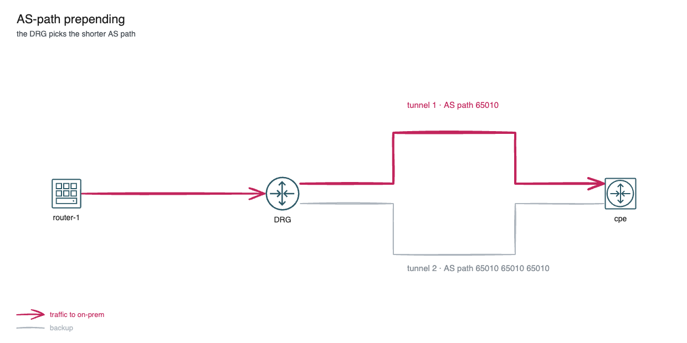

# BGP hands-on, part 2: path selection and its limits

*Part 4 of 6 in the OCI Always Free BGP lab series. Previous: [BGP sessions and policy](03-bgp-sessions-and-policy.md). Next: [DRG routing and the missing Route Server](05-drg-routing-no-route-server.md).*

[Part 3](03-bgp-sessions-and-policy.md) brought up the lab's three eBGP sessions: the cpe peers with the DRG over each of the two tunnels, and with router-1 through the VPN. Every session has an inbound and an outbound route-map. This article uses those sessions to look at the AS path: how it prevents loops, and how you can steer traffic onto one tunnel with prepending and local-preference. The last exercise shows where BGP stops being useful in OCI.

## How BGP picks a path

When BGP has several paths to the same prefix, it compares them attribute by attribute until one wins. The full list is long. The first steps that matter in this lab are:

1. **Highest local-preference.** You set it on routes you receive, and it stays inside your AS. It decides which way *your* traffic leaves.
2. **Shortest AS path.** The neighbor sees your AS path, so prepending your own ASN makes a path less attractive *to them*. It decides which way traffic comes *back* to you.

With equal attributes, `maximum-paths` lets FRR use several paths at once. The cpe has `maximum-paths 2`, so by default it sends traffic over both tunnels (ECMP).

The AS path also prevents loops. Every AS adds its own number when it passes a route on, and a router drops any route whose path already contains its own ASN.



## Exercises

Run FRR commands with `sudo vtysh` (or `sudo vtysh -c "<command>"`). Exercises 2 and 3 work together, but each exercise ends with a cleanup step, so you can do them in any order. Each one has an **Azure link** and an **AWS link** that names the same decision in those clouds. The expected outputs come from the configs and FRR's documented behaviour; they have not been captured from a live run yet.

### Exercise 1: AS path and loop prevention

The cpe learns the hub subnets from the DRG over both tunnels. Let it advertise them back to OCI:

```
# cpe
conf t
ip prefix-list ONPREM permit 10.0.0.0/16 le 24
end
clear bgp 169.254.21.1 soft out
clear bgp 169.254.22.1 soft out
show bgp neighbors 169.254.22.1 advertised-routes
```

The cpe now sends 10.0.0.0/24 and 10.0.1.0/24 to the DRG with path `65010 31898`. In the console, *DRG → DRG route tables → Get all route rules* still shows them only through the VCN attachment, never through a tunnel. The path already contains 31898, the DRG's own ASN, so the DRG treats it as a loop and drops it. FRR has a knob for the receiving side (`neighbor … allowas-in`); cloud gateways don't expose it.

**Azure link:** this is why an NVA can't hand Azure Route Server back a route that ARS learned from the VPN/ER gateway: the path already contains 65515, so ARS drops it.
**AWS link:** the same eBGP rule applies to the Amazon-side ASN of a virtual private gateway or Transit Gateway: a path that already contains it is dropped.

Clean up: `no ip prefix-list ONPREM permit 10.0.0.0/16 le 24` on the cpe, then the two soft clears.

### Exercise 2: Tunnel preference with AS-path prepending

Make tunnel 2 the backup for traffic coming *from* OCI:

```
# cpe
conf t
route-map OCI-T2-OUT permit 10
 match ip address prefix-list ONPREM
 set as-path prepend 65010 65010
router bgp 65010
 address-family ipv4 unicast
  neighbor 169.254.22.1 route-map OCI-T2-OUT out
end
clear bgp 169.254.22.1 soft out
```

In the console, *DRG → DRG route tables → Get all route rules* still lists 172.16.0.0/24 and 192.168.100.0/24, now only through tunnel 1. Run `ping 172.16.0.10` on router-1 and watch `sudo ipsec trafficstatus` on the cpe: only tunnel 1's inbound counter grows. The cpe still sends its own traffic over both tunnels (ECMP). Exercise 3 fixes that direction.

**Azure link:** prepending on one link of an active-active VPN or ExpressRoute is how on-prem picks the primary path into Azure.
**AWS link:** AWS also prefers the shorter AS path when choosing between VPN tunnels, so prepending sets the active tunnel.

Keep this config for exercise 3, or clean up: `neighbor 169.254.22.1 route-map ONPREM-ONLY out`, `no route-map OCI-T2-OUT`, then the soft clear.

### Exercise 3: Local-preference for the outbound direction

Prepending changes what the DRG picks. To make the cpe itself prefer tunnel 1, lower the local-preference of everything it learns over tunnel 2:

```
# cpe
conf t
route-map OCI-T2-IN permit 10
 match ip address prefix-list HUB
 set local-preference 50
router bgp 65010
 address-family ipv4 unicast
  neighbor 169.254.22.1 route-map OCI-T2-IN in
end
clear bgp 169.254.22.1 soft in
show bgp ipv4 unicast 10.0.1.0/24
show ip route bgp
```

`show bgp ipv4 unicast 10.0.1.0/24` lists two paths. The one from 169.254.21.1, with the default local-preference 100, is `best`; the one from 169.254.22.1 shows `localpref 50`. The paths are no longer equal, so ECMP is gone and `show ip route bgp` has one next hop per hub subnet, through `vti1`. With exercise 2 still in place, both directions now use tunnel 1 and tunnel 2 is a real backup. Take tunnel 1 down with `sudo ipsec auto --down oci-tunnel-1` and both directions move to tunnel 2.

The route-map has only one `permit` entry, and it matches `HUB`, so it filters the same prefixes as `FROM-OCI`. Anything it didn't match would be dropped.

**Azure link:** on-prem sets local-preference on routes learned from the two Azure VPN or ExpressRoute paths to pick the primary path *to* Azure.
**AWS link:** the same for routes learned from the two tunnels (or Direct Connect vs VPN): the customer gateway decides with local-preference.

Clean up: `neighbor 169.254.22.1 route-map FROM-OCI in`, `no route-map OCI-T2-IN`, then `clear bgp 169.254.22.1 soft in`. Clean up exercise 2 too if you kept it, and bring tunnel 1 back with `sudo ipsec auto --up oci-tunnel-1`.

### Exercise 4: The route that goes nowhere

On the cpe:

```bash
sudo vtysh -c "show ip route 10.255.0.1"     # via 10.0.1.11, recursive through vti1/vti2
ping -c3 -I 192.168.100.1 10.255.0.1         # fails
```

The cpe has a valid BGP route to router-1's loopback, but the ping fails. The packet goes into the tunnel, and the DRG has no route for 10.255.0.0/24, because nothing advertised it to OCI. router-1's BGP session changes routing on the cpe and on router-1 and nowhere else; the VCN route tables and the DRG never see it.

This is the main lesson of the lab. In Azure, Azure Route Server would learn 10.255.0.1/32 from router-1 and program it into the VNet and the VPN gateway. AWS has VPC Route Server for the same job. OCI has no equivalent: only the DRG's own BGP sessions, over IPSec or FastConnect, change OCI routing. [Part 5](05-drg-routing-no-route-server.md) makes the ping work with static routes.

**Azure link:** without Azure Route Server, a VNet ignores BGP on an NVA too; the route has to be a UDR.
**AWS link:** without VPC Route Server, a VPC route table only gets the appliance's prefixes as static routes.

## Links

* [BGP — FRR latest documentation](https://docs.frrouting.org/en/latest/bgp.html): route selection, `as-path prepend`, `local-preference`, `allowas-in`, route-maps
* [Dynamic Routing Gateways](https://docs.oracle.com/en-us/iaas/Content/Network/Tasks/managingDRGs.htm): DRG route tables and what the DRG learns over BGP
* [About BGP and VPN Gateway](https://learn.microsoft.com/en-us/azure/vpn-gateway/vpn-gateway-bgp-overview): BGP over S2S VPN, ASN 65515, APIPA peer addresses
* [What is Azure Route Server?](https://learn.microsoft.com/en-us/azure/route-server/overview): BGP between NVAs and the VNet, which OCI doesn't have
* [Tunnel options for your AWS Site-to-Site VPN connection](https://docs.aws.amazon.com/vpn/latest/s2svpn/VPNTunnels.html): two tunnels per connection, inside CIDRs, IKE settings
* [Dynamic routing in your VPC using VPC Route Server](https://docs.aws.amazon.com/vpc/latest/userguide/dynamic-routing-route-server.html): BGP from appliances into VPC route tables, which OCI doesn't have
