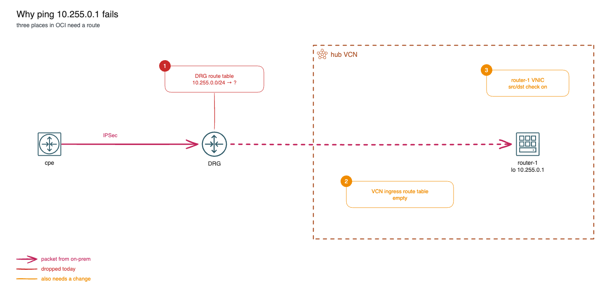

# DRG routing and the missing Route Server

*Part 5 of 6 in the OCI Always Free BGP lab series. Previous: [BGP path selection and its limits](04-bgp-path-selection.md). Next: [Load balancers in a hybrid setup](06-load-balancers-hybrid.md).*

[Part 4](04-bgp-path-selection.md) ended with a route that goes nowhere: the cpe learns router-1's loopback 10.255.0.1/32 over BGP, but a ping to it dies in the DRG. Azure and AWS can fix this with BGP (Azure Route Server, AWS VPC Route Server). OCI can't, so this article fixes it the OCI way, with static routes, and looks at how the DRG decides where a packet goes.

## The three decisions



A packet from on-prem to 10.255.0.1 meets three places that decide what happens to it:

1. **The DRG route table of the attachment it arrives on.** Each DRG attachment (VCN, IPSec tunnel, virtual circuit, remote peering) has a DRG route table that routes packets *entering the DRG* through it. By default the DRG has two auto-generated tables: one for VCN attachments and one for everything else, including the IPSec tunnels. The tunnels' table imports the hub VCN's subnets, 10.0.0.0/24 and 10.0.1.0/24, with the VCN attachment as next hop. There's no route for 10.255.0.0/24, so the packet is dropped here.
2. **The VCN route table of the DRG attachment.** A VCN attachment also has a VCN route table, which routes packets *entering the VCN* from the DRG. Oracle sometimes calls it the ingress route table. In the lab it exists but is empty (`oci_core_route_table.drg_ingress` in `network.tf`), so the packet goes to the subnet that contains its destination. 10.255.0.1 isn't in any subnet. This table can only target a private IP, a service gateway or a local peering gateway.
3. **router-1's VNIC.** By default, a VNIC drops packets whose destination (inbound) or source (outbound) isn't one of its own IPs. 10.255.0.1 is only on router-1's loopback, not an address OCI assigned.

How routes get into the DRG route tables:

- **Import distributions** decide which attachments' routes a DRG route table learns dynamically. The auto-generated ones import from the VCN attachments, or from all attachments.
- **The export distribution** decides what the DRG advertises to an attachment. For an IPSec tunnel, that's what the DRG sends over BGP: the contents of the tunnel's DRG route table, except routes learned from other tunnels or virtual circuits.
- **Static route rules** can be added to any DRG route table, with an attachment as next hop.

## Exercise: Make the loopbacks reachable

Find a configuration that makes `ping -I 192.168.100.1 10.255.0.1` from the cpe work. Make the change in Terraform (`vpn.tf`, `network.tf`, `compute.tf`), not in the console, so `terraform destroy` still cleans up.

Hints:

- Advertising 10.255.0.0/24 from the cpe to OCI doesn't help: the DRG would learn it from the tunnel and send it straight back.
- Which DRG route table decides where the DRG sends a packet that came from the tunnels? Can a rule there point at the hub VCN attachment?
- What can the attachment's VCN route table (empty today) do with a destination that isn't in any subnet?
- router-1 must receive packets for 10.255.0.1 and send replies from it.
- Check the return path too: router-1 replies to 192.168.100.1.

**Azure link:** Azure Route Server learns 10.255.0.1/32 from the NVA over BGP and programs it into the VNet and the VPN gateway, so none of the static work is needed. Without Route Server, the equivalent is a UDR on the GatewaySubnet and IP forwarding on the NIC.
**AWS link:** VPC Route Server does the same for VPC route tables (next hop = the appliance's ENI); without it, a gateway route table with an edge association on the virtual private gateway, and source/destination check off on the ENI.

### Solution

Try it yourself first. One working answer needs three changes, one per decision in the diagram.

**1. DRG: send 10.255.0.0/24 from the tunnels to the hub VCN.** Add a static rule to the auto-generated DRG route table that the IPSec tunnels use (`vpn.tf`):

```hcl
resource "oci_core_drg_route_table_route_rule" "loopbacks" {
  drg_route_table_id         = oci_core_drg.hub.default_drg_route_tables[0].ipsec_tunnel
  destination                = "10.255.0.0/24"
  destination_type           = "CIDR_BLOCK"
  next_hop_drg_attachment_id = oci_core_drg_attachment.hub.id
}
```

**2. VCN: send it from the DRG attachment to router-1.** Give the empty ingress route table a rule whose target is router-1's private IP (`network.tf`):

```hcl
data "oci_core_private_ips" "router" {
  ip_address = local.ip.router_1
  subnet_id  = oci_core_subnet.nva.id
}

resource "oci_core_route_table" "drg_ingress" {
  compartment_id = var.compartment_id
  vcn_id         = oci_core_vcn.hub.id
  display_name   = "${var.name_prefix}-rt-drg-ingress"

  route_rules {
    destination       = "10.255.0.0/24"
    network_entity_id = data.oci_core_private_ips.router.private_ips[0].id
  }
}
```

**3. router-1: accept and send traffic for an address OCI didn't assign.** Turn off the source/destination check on its VNIC (`compute.tf`):

```hcl
  create_vnic_details {
    subnet_id              = oci_core_subnet.nva.id
    private_ip             = local.ip.router_1
    assign_public_ip       = true
    skip_source_dest_check = true
    hostname_label         = "router-1"
  }
```

The return path needs nothing new: router-1 replies from 10.255.0.1 to 192.168.100.1, the `nva` route table sends 192.168.100.0/24 to the DRG, and the DRG knows it from BGP. The hub's security list already allows traffic from 192.168.100.0/24.

Run `terraform plan` and check that it only adds the rule and the data source and updates the route table and the VNIC in place, then apply. On the cpe:

```bash
ping -c3 -I 192.168.100.1 10.255.0.1
```

The ping now works. In the console, *DRG → DRG route tables → (the IPSec table) → Get all route rules* shows the new static rule. The DRG also exports it to the tunnels, so it advertises 10.255.0.0/24 to the cpe over BGP. The cpe's `FROM-OCI` route-map only accepts 10.0.0.0/16 and longer, so it drops it, and the cpe keeps using the more specific 10.255.0.1/32 from router-1 anyway.

This is the pattern Oracle documents as transit routing through a private IP in a hub VCN, usually with a firewall as the target. Note what is still missing compared with Route Server: if router-1 started advertising a new prefix, someone would have to add it to both route tables by hand.

Clean up: `git checkout -- vpn.tf network.tf compute.tf` and `terraform apply`, or keep the changes and run `terraform destroy` at the end.

## Azure and AWS equivalents

| This lab (OCI) | Azure | AWS |
|---|---|---|
| DRG route table of the IPSec attachment | VPN gateway's learned and effective routes | Transit Gateway route table |
| VCN route table on the DRG attachment | UDR on GatewaySubnet | Gateway route table (edge association on the VGW) |
| Private IP as route target | *Virtual appliance* next hop | ENI as route target |
| `skip_source_dest_check` | IP forwarding on the NIC | Source/destination check off on the ENI |
| *(no equivalent)* | Azure Route Server | VPC Route Server, Transit Gateway Connect |

## Links

* [Dynamic Routing Gateways](https://docs.oracle.com/en-us/iaas/Content/Network/Tasks/managingDRGs.htm): DRG attachments, DRG route tables, import and export distributions
* [VCN Route Tables](https://docs.oracle.com/en-us/iaas/Content/Network/Tasks/managingroutetables.htm#Route): private IP as a route target and the source/destination check
* [Transit Routing inside a hub VCN](https://docs.oracle.com/en-us/iaas/Content/Network/Tasks/transitrouting.htm): the DRG attachment's route table pointing at a private IP in the hub
* [About VPN Gateway configuration settings](https://learn.microsoft.com/en-us/azure/vpn-gateway/vpn-gateway-about-vpn-gateway-settings#gwsub): GatewaySubnet rules (UDRs allowed, but no 0.0.0.0/0 and no NSG)
* [Azure virtual network traffic routing](https://learn.microsoft.com/en-us/azure/virtual-network/virtual-networks-udr-overview): UDRs and the *Virtual appliance* next hop
* [What is Azure Route Server?](https://learn.microsoft.com/en-us/azure/route-server/overview): BGP between NVAs and the VNet, which OCI doesn't have
* [Gateway route tables](https://docs.aws.amazon.com/vpc/latest/userguide/gateway-route-tables.html): ingress routing on the virtual private gateway, the DRG attachment ingress route table equivalent
* [Dynamic routing in your VPC using VPC Route Server](https://docs.aws.amazon.com/vpc/latest/userguide/dynamic-routing-route-server.html): BGP from appliances into VPC route tables, which OCI doesn't have
* [Connect attachments and Connect peers in AWS Transit Gateway](https://docs.aws.amazon.com/vpc/latest/tgw/tgw-connect.html): GRE + BGP between an appliance and a Transit Gateway
