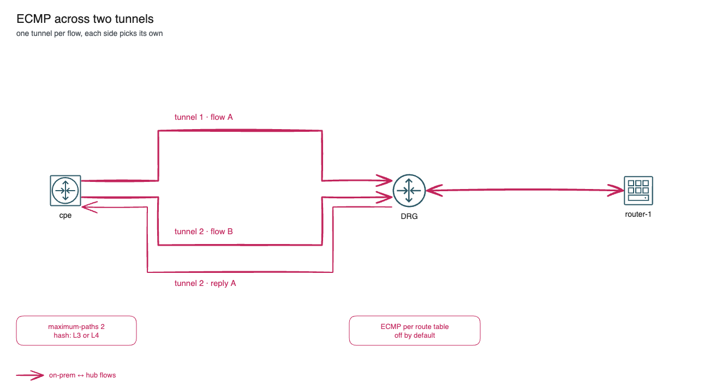

# ECMP across two tunnels: flow hashing, asymmetric routing, failover

*Part 5 of 8 in the OCI Always Free BGP lab series. Previous: [BGP path selection and its limits](04-bgp-path-selection.md). Next: [DRG routing and the missing Route Server](06-drg-routing-no-route-server.md).*

OCI gives every Site-to-Site VPN connection two tunnels. [Part 4](04-bgp-path-selection.md) used BGP to pick one of them and keep the other as a backup. This article goes the other way and uses both at once with equal-cost multi-path routing (ECMP). It covers three side effects: traffic is split per flow, not per packet; a request and its reply can take different tunnels; and when a tunnel dies, its flows stay broken until BGP notices.

## Two directions, two decisions



Each end decides on its own which tunnel a packet takes.

- **cpe → OCI.** The cpe learns 10.0.0.0/24 and 10.0.1.0/24 from the DRG over both tunnels, with the same attributes. FRR's `maximum-paths 2` installs both paths, so the kernel gets one route with two next hops, `vti1` and `vti2`. FRR only treats eBGP paths as equal when they come from neighbors in the same AS. Both DRG sessions are AS 31898, so that holds.
- **OCI → cpe.** The DRG learns 172.16.0.0/24 and 192.168.100.0/24 over both tunnels. ECMP is set per DRG route table and is off by default. With ECMP off and equal AS paths, Oracle's documentation says the DRG "makes an arbitrary but stable selection". In *Get all route rules*, one tunnel shows *Active* and the other *Conflict*. With ECMP on, both are *Active*. Only routes with the same route preference qualify, so the prepending from part 4 takes tunnel 2 out again.

## Per flow, not per packet

Neither side sprays packets round-robin. Each hashes the packet's header fields and maps the result to one path, so all packets of a flow take the same tunnel and arrive in order.

- **Linux** hashes only the source and destination IP by default (`net.ipv4.fib_multipath_hash_policy = 0`). One cpe talking to one host always uses the same tunnel. Policy `1` adds the protocol and ports, so each TCP connection can take a different tunnel.
- **The DRG** uses the protocol, source and destination IP and ports. Oracle notes that you need several flows to use all the bandwidth.

## Asymmetric routing

The two hashes are independent. A request can leave the cpe on `vti1` and its reply can come back on `vti2`. Oracle says so in its VPN documentation: traffic from a VCN to on-prem can use any tunnel that's up. That's why the cpe's cloud-init turns off `rp_filter` ([part 2](02-site-to-site-vpn-libreswan.md)). In strict mode, Linux drops a packet when its route back to the source doesn't use the interface the packet arrived on.

## Exercises

Run FRR commands with `sudo vtysh`. Exercises 3 and 4 build on the DRG ECMP from exercise 2. The *Active*/*Conflict* listing was seen in a live run. The other expected outputs come from the configs and the vendors' documentation; they have not been captured from a live run yet.

### Exercise 1: ECMP on the cpe

On the cpe:

```bash
ip route show 10.0.1.0/24     # proto bgp, two "nexthop via ... dev vti1/vti2" lines
for p in $(seq 40001 40010); do ip route get 10.0.1.100 ipproto tcp sport $p dport 80 | grep -o 'dev vti.'; done
```

`ip route get` asks the kernel which next hop it would pick, without sending anything. All ten lines show the same tunnel: the default hash ignores ports. Switch to the L4 hash and ask again:

```bash
sudo sysctl -w net.ipv4.fib_multipath_hash_policy=1
for p in $(seq 40001 40010); do ip route get 10.0.1.100 ipproto tcp sport $p dport 80 | grep -o 'dev vti.'; done
```

Now the lines are a mix of `vti1` and `vti2`. Send real traffic through the NLB and compare the TX counters before and after:

```bash
ip -s link show vti1; ip -s link show vti2
for i in $(seq 20); do curl -s -o /dev/null http://10.0.1.100; done
ip -s link show vti1; ip -s link show vti2
```

Each `curl` opens a new connection from a new source port, so both counters grow.

**Azure link:** with an active-active VPN gateway, it's up to the on-prem device to spread its traffic over both tunnels.
**AWS link:** the same for the customer gateway and the two tunnels of a VPN connection.

Clean up: `sudo sysctl -w net.ipv4.fib_multipath_hash_policy=0`.

### Exercise 2: ECMP on the DRG

Traffic from the hub enters the DRG through the VCN attachment, so the table that decides is the VCN attachment's. In the console, open *DRG → DRG route tables → Autogenerated Drg Route Table for VCN attachments → Get all route rules*. 172.16.0.0/24 and 192.168.100.0/24 are there twice: *Active* through one tunnel, *Conflict* through the other.

On the cpe, watch which tunnel new TCP connections from router-1 arrive on:

```bash
sudo tcpdump -ni any 'src 10.0.1.11 and dst port 22 and tcp[tcpflags] & tcp-syn != 0'
```

On router-1, open 20 connections to the cpe's SSH port. Each one uses a new source port:

```bash
for i in $(seq 20); do timeout 1 bash -c '</dev/tcp/172.16.0.10/22'; done
```

All 20 SYNs arrive on the same `vti`, the *Active* one. Now edit the table (*Edit* on the table's page) and turn on ECMP. In Terraform, that's `is_ecmp_enabled` on `oci_core_drg_route_table`. *Get all route rules* now shows both tunnels as *Active*. Run the loop again: the SYNs arrive on both `vti1` and `vti2`.

**Azure link:** an active-active VPN gateway uses both tunnels at once and keeps each TCP or UDP flow on one tunnel. There is no switch for it.
**AWS link:** a virtual private gateway doesn't do ECMP: it picks one tunnel. A Transit Gateway with *VPN ECMP support* does, if both tunnels advertise the same ASN and AS path.

Keep ECMP on for exercises 3 and 4, or clean up: edit the table again and turn ECMP off. Terraform doesn't manage the autogenerated tables, so `terraform apply` won't do it for you.

### Exercise 3: Asymmetric routing and rp_filter

Make the cpe use only tunnel 1 towards the hub, with the local-preference from part 4:

```
# cpe
conf t
route-map OCI-T2-IN permit 10
 match ip address prefix-list HUB
 set local-preference 50
router bgp 65010
 address-family ipv4 unicast
  neighbor 169.254.22.1 route-map OCI-T2-IN in
end
clear bgp 169.254.22.1 soft in
```

`ip route show 10.0.1.0/24` now has one next hop, `vti1`. The DRG still spreads its flows over both tunnels. Turn on strict reverse-path filtering and run the loop on router-1 again, with a visible result:

```bash
# cpe
sudo sysctl -w net.ipv4.conf.all.rp_filter=1
# router-1
for i in $(seq 20); do timeout 1 bash -c '</dev/tcp/172.16.0.10/22' && echo ok || echo dropped; done
# cpe
nstat -az TcpExtIPReversePathFilter
```

Roughly half the connections fail: the ones whose SYN arrived on `vti2`, because the cpe's route back to 10.0.1.11 only uses `vti1`. The counter shows how many packets the filter dropped. The kernel uses the higher of `all` and the interface's own value, so setting `all` is enough. Loose mode (`=2`) only checks that *some* route to the source exists, and all 20 succeed. With ECMP on the cpe, even strict mode passes, because the route back uses both interfaces.

**Azure link:** Azure sends traffic to on-prem over both active-active tunnels "even if your on-premises VPN device might favor one tunnel over the other", so the on-prem device has to accept replies on either.
**AWS link:** AWS can also change which tunnel it uses for egress at any time, so the customer gateway needs the same tolerance.

Clean up: `sudo sysctl -w net.ipv4.conf.all.rp_filter=0`, then in vtysh `no neighbor 169.254.22.1 route-map OCI-T2-IN in`, `no route-map OCI-T2-IN` and `clear bgp 169.254.22.1 soft in`.

### Exercise 4: How long does failover take?

ECMP on the cpe sends flows to every next hop BGP installed, whether the tunnel underneath works or not. Find the tunnel your ping uses, start a ping with timestamps, and take that tunnel down:

```bash
# cpe, session 1
ip route get 10.0.1.11                       # e.g. dev vti1
ping -D -O -i 0.5 10.0.1.11                  # -O prints "no answer yet" for every lost reply
# cpe, session 2
sudo ipsec auto --down oci-tunnel-1          # the tunnel from ip route get
watch -n 5 'sudo vtysh -c "show bgp summary"'
```

The ping stops. The cpe keeps sending it into `vti1`, where there is no IPSec SA any more, until the BGP session over tunnel 1 expires and FRR removes that next hop. With `frr defaults traditional` the cpe offers a 180-second hold time, and the peers use the lower of the two offers. `sudo vtysh -c "show bgp neighbors 169.254.21.1" | grep -i hold` shows the value agreed. Count the timestamps between the last reply and the first new one.

Bring the tunnel back with `sudo ipsec auto --up oci-tunnel-1` and wait for the session to be Established. Then lower the timers on both DRG sessions and repeat:

```
# cpe
conf t
router bgp 65010
 neighbor OCI timers 10 30
end
clear bgp 169.254.21.1
clear bgp 169.254.22.1
```

The outage now ends within about 30 seconds, if the DRG accepted the shorter hold time. If a session doesn't come back to Established, remove the timers again. Short timers detect failures faster but cost more keepalives, and a busy link can drop a healthy session.

**Azure link:** an active-active VPN gateway fails over the same way: BGP removes the paths of the dead tunnel.
**AWS link:** AWS also prefers healthy tunnels: tunnel health takes precedence over every other routing attribute.

Clean up: `sudo ipsec auto --up oci-tunnel-1` if the tunnel is still down, `no neighbor OCI timers 10 30` under `router bgp 65010`, the two `clear bgp` commands, and turn ECMP off on the DRG table if you kept it from exercise 2.

## Azure and AWS equivalents

| This lab (OCI) | Azure | AWS |
|---|---|---|
| `maximum-paths 2` on the cpe | ECMP on the on-prem device | ECMP on the customer gateway |
| ECMP per DRG route table, off by default | Active-active gateway: both tunnels, one tunnel per flow | VGW: one tunnel; TGW: *VPN ECMP support* |
| *Conflict*: the DRG's backup path | Single-instance (active-standby) gateway | The VGW's standby tunnel |
| `rp_filter` off on the cpe | On-prem accepts replies on either tunnel | Customer gateway accepts replies on either tunnel |

## Links

* [Dynamic Routing Gateways](https://docs.oracle.com/en-us/iaas/Content/Network/Tasks/managingDRGs.htm): ECMP per DRG route table, flow hashing, how the DRG resolves route conflicts
* [Site-to-Site VPN Overview](https://docs.oracle.com/en-us/iaas/Content/Network/Tasks/overviewIPsec.htm): asymmetric routing over the tunnels, ways to prefer one
* [oci_core_drg_route_table](https://registry.terraform.io/providers/oracle/oci/latest/docs/resources/core_drg_route_table): the `is_ecmp_enabled` argument
* [BGP — FRR latest documentation](https://docs.frrouting.org/en/latest/bgp.html): `maximum-paths`, `bgp bestpath as-path multipath-relax`, neighbor timers
* [Basic Commands — FRR latest documentation](https://docs.frrouting.org/en/latest/basic.html): `frr defaults traditional` and its BGP timers
* [IP Sysctl](https://docs.kernel.org/networking/ip-sysctl.html): `fib_multipath_hash_policy` and `rp_filter`
* [About active-active VPN gateways](https://learn.microsoft.com/en-us/azure/vpn-gateway/about-active-active-gateways): both tunnels at once, one tunnel per flow
* [Design highly available gateway connectivity](https://learn.microsoft.com/en-us/azure/vpn-gateway/vpn-gateway-highlyavailable): active-active and dual-redundancy designs
* [Route tables and AWS Site-to-Site VPN route priority](https://docs.aws.amazon.com/vpn/latest/s2svpn/vpn-route-priority.html): no ECMP on a virtual private gateway, how it picks a tunnel
* [Create a transit gateway in AWS Transit Gateway](https://docs.aws.amazon.com/vpc/latest/tgw/create-tgw.html): the *VPN ECMP support* option and its conditions
