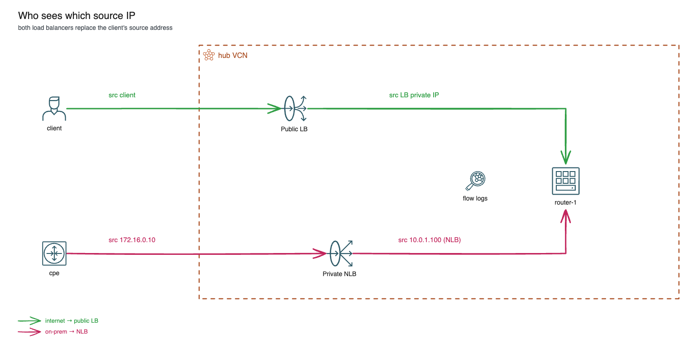

# Load balancers in a hybrid setup: public LB vs private NLB

*Part 5 of 5 in the OCI Always Free BGP lab series. Previous: [DRG routing and the missing Route Server](04-drg-routing-no-route-server.md). Back to the start: [A free hybrid-networking lab on Oracle Cloud](01-free-oci-hybrid-lab.md).*

The lab's "application" is nginx on router-1, and two load balancers sit in front of it: a public flexible Load Balancer for the internet, and a private Network Load Balancer for on-prem, reached through the VPN. Always Free includes one of each. They solve the same problem in different ways, and the difference shows up in one question: which source IP does the backend see?

## Two load balancers



| | Public LB (`load_balancers.tf`) | Private NLB |
|---|---|---|
| Layer | HTTP (L7) listener on port 80 | TCP (L4) listener on port 80 |
| Address | public IP, in the `lb` subnet | 10.0.1.100, in the `nva` subnet |
| Clients | the internet | on-prem, through the VPN |
| Connection to router-1 | a new TCP connection from the LB's private IP | the client's TCP stream, with the source rewritten |
| Client IP for the backend | `X-Forwarded-For` and `X-Real-IP` headers | lost (`is_preserve_source = false`) |
| Always Free | 1, 10 Mbps | 1 |

**The public LB is a full proxy.** It ends the client's TCP (and TLS, if configured) connection and opens its own connection to the backend. router-1 sees the LB's private IP in the `lb` subnet as the client. The LB adds headers so the application can still find the real client: `X-Real-IP` is the client's address, and `X-Forwarded-For` appends it to whatever the client already sent.

**The NLB passes packets through.** It doesn't end the connection, it forwards it. It can keep the client's source IP (`is_preserve_source = true`), and then router-1 would see 172.16.0.10. The lab turns that off. The NLB replaces the source with its own IP, 10.0.1.100, so router-1's reply goes back to the NLB and the return path can't bypass it.

**Health checks.** Both check `GET /` on port 80 and send traffic only to healthy backends. The NLB's backend set uses a five-tuple hash to spread connections; the LB uses round robin. With one backend, neither matters, but the health checks do (exercise 3).

**Security lists.** The `lb` subnet allows TCP 80 from anywhere. router-1's subnet only allows traffic from the hub, from on-prem and SSH from your IP. That's enough for both load balancers, because both connect to router-1 from an address inside the hub VCN.

## Exercises

Each exercise ends with a cleanup step. The expected outputs come from the configs and Oracle's documentation; they have not been captured from a live run yet.

### Exercise 1: Who is the client?

On router-1:

```bash
sudo tcpdump -lni ens3 -A tcp port 80 | grep -iE "^(GET|X-Real-IP|X-Forwarded-For)|IP "
```

Then make one request through each load balancer:

```bash
curl -s http://10.0.1.100        # on the cpe: through the NLB
curl -s <app_url>                # on your laptop: through the public LB
```

The NLB request arrives from 10.0.1.100, with no extra headers. The public LB request arrives from an address in 10.0.0.0/24, and the HTTP request carries `X-Real-IP` and `X-Forwarded-For` with your laptop's public IP. You'll also see the health checks from both load balancers, every few seconds.

**Azure link:** Application Gateway also adds `X-Forwarded-For`; the Standard Load Balancer keeps the client IP and doesn't proxy.
**AWS link:** an ALB adds `X-Forwarded-For`; an NLB keeps the client IP by default for instance targets, and can use proxy protocol v2 otherwise.

### Exercise 2: Flow logs

*Logging → Log groups → bgp-lab-logs → nva flow log* shows accepted flows in the router subnet. Run `curl http://10.0.1.100` on the cpe a few times, wait a few minutes, and find two sets of records: 172.16.0.10 → 10.0.1.100:80 (on-prem to the NLB) and 10.0.1.100 → 10.0.1.11:80 (the NLB to router-1, after the source is replaced). Do the same for `curl <app_url>` from your laptop and find the flow from the public LB's private IP in `lb` to 10.0.1.11:80. Your laptop's IP doesn't appear in the `nva` flow log at all.

**Azure link:** VNet flow logs (the successor to NSG flow logs) record the same flows on the backend's NIC.
**AWS link:** VPC Flow Logs on the target's ENI; with an NLB, the flows show the load balancer's private IP unless client IP preservation is on.

### Exercise 3: A failed backend

Stop nginx on router-1:

```bash
sudo systemctl stop nginx
```

Within a minute, both load balancers mark router-1 unhealthy. In the console, *Load balancers → (LB) → Backend sets → app* and *Network load balancers → (NLB) → Backend sets → web* show the backend as *Critical*. Then:

```bash
curl -si <app_url> | head -1       # your laptop: the LB answers itself, with an HTTP 5xx error
curl -s -m 5 http://10.0.1.100     # the cpe: no healthy backend, the connection fails
```

The public LB is a proxy, so it can still answer the client, with an error page. The NLB has nothing to answer with: the connection fails.

Clean up: `sudo systemctl start nginx`, and wait for both backends to turn *OK*.

**Azure link:** Application Gateway returns 502 when no backend is healthy; the Standard Load Balancer stops sending new flows to instances whose health probe fails.
**AWS link:** ALB and NLB both fail open: when every target is unhealthy, they send to all of them anyway (here the connection would be refused). An ALB with no registered targets returns 503.

## Azure and AWS equivalents

| This lab (OCI) | Azure | AWS |
|---|---|---|
| Public flexible LB (HTTP listener) | Application Gateway, or a public Standard Load Balancer for L4 | Application Load Balancer |
| Private NLB | Internal Standard Load Balancer | Internal Network Load Balancer |
| `is_preserve_source` | (the Standard LB always keeps the client IP) | Client IP preservation |
| VCN flow logs | VNet flow logs | VPC Flow Logs |

## Links

* [Overview of Load Balancer](https://docs.oracle.com/en-us/iaas/Content/Balance/Concepts/balanceoverview.htm): the public flexible LB
* [Load Balancer Headers](https://docs.oracle.com/iaas/Content/Balance/Reference/httpheaders.htm): `X-Forwarded-For`, `X-Real-IP` and the other headers the LB adds
* [Overview of Flexible Network Load Balancer](https://docs.oracle.com/en-us/iaas/Content/NetworkLoadBalancer/overview.htm): the L4 NLB and source/destination preservation
* [Flow Logs](https://docs.oracle.com/en-us/iaas/Content/Network/Concepts/vcn_flow_logs.htm): VCN flow logs and where they are stored
* [What is Azure Load Balancer?](https://learn.microsoft.com/en-us/azure/load-balancer/load-balancer-overview): internal and public Standard Load Balancer
* [What is a Network Load Balancer?](https://docs.aws.amazon.com/elasticloadbalancing/latest/network/introduction.html): the internal L4 load balancer, like the OCI NLB here
* [What is an Application Load Balancer?](https://docs.aws.amazon.com/elasticloadbalancing/latest/application/introduction.html): the full-proxy HTTP LB, like the OCI public LB
