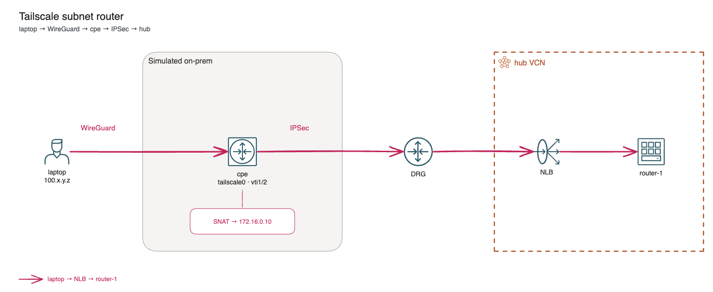

# Remote access to a hybrid lab: the CPE as a Tailscale subnet router

*Part 7 of 7 in the OCI Always Free BGP lab series. Previous: [Load balancers in a hybrid setup](06-load-balancers-hybrid.md). Back to the start: [A free hybrid-networking lab on Oracle Cloud](01-free-oci-hybrid-lab.md).*

So far the only on-prem client in the lab has been the cpe itself, and you reach the VMs over SSH to their public IPs. In a real hybrid network, people also work remotely: they connect to the corporate network with a client VPN and reach the cloud through the Site-to-Site VPN behind it. This article builds that with [Tailscale](https://tailscale.com/), a WireGuard mesh VPN. Its free Personal plan is enough, and the lab adds no OCI resources: Tailscale runs on the existing cpe VM, which becomes a *subnet router*. Your laptop then reaches the private NLB and router-1 the way an on-prem user would: over WireGuard to the cpe, then through the IPSec tunnels to the DRG.

## How the path works



A packet from your laptop to the NLB (10.0.1.100) crosses three layers:

1. **The tailnet.** Every device in your Tailscale network (the tailnet) gets an address from 100.64.0.0/10. The cpe advertises three routes to the tailnet: the hub VCN (10.0.0.0/16), the on-prem subnet (172.16.0.0/24) and the on-prem "LAN" (192.168.100.0/24). Once you approve them, your laptop sends those destinations over WireGuard to the cpe's `tailscale0` interface. Tailscale tries to connect the two devices directly through NAT, and falls back to its DERP relays when it can't. The cpe's security list doesn't need a new rule for this.
2. **The cpe.** The packet arrives on `tailscale0`, and the cpe routes it like any other: it learned 10.0.1.0/24 over BGP from both tunnels, so it sends the packet out through `vti1` or `vti2`. On the way out, an iptables rule replaces the source 100.x.y.z with 172.16.0.10.
3. **OCI.** From here the packet is ordinary on-prem traffic: tunnel, DRG, NLB, router-1. The reply goes to 172.16.0.10, back through the tunnel to the cpe, which reverses the SNAT and sends it over WireGuard to the laptop.

Nothing in OCI knows about 100.64.0.0/10. That's the job of the SNAT: the hub only ever sees 172.16.0.10, which the `nva` route table and the security lists already handle.

## Why the lab does its own SNAT

Tailscale has SNAT built in, and on Linux it's on by default (`--snat-subnet-routes`). It uses iptables `MASQUERADE`, which picks the address of the interface the packet leaves through. On the cpe that interface is `vti1` or `vti2`, and their addresses are 169.254.21.2 and 169.254.22.2. The hub has no route back to 169.254.x.x, so the replies would go to the internet gateway and get lost.

So `tailscale.tf` turns Tailscale's SNAT off and adds a rule that always uses the cpe's own address:

```bash
iptables -t nat -A POSTROUTING -s 100.64.0.0/10 -o vti+ -j SNAT --to-source 172.16.0.10
```

This is the same problem the `SET-SRC` route-map solves for the cpe's own traffic ([part 2](02-site-to-site-vpn-libreswan.md)): on a route-based VPN, the tunnel interface's address is a bad source.

## Prerequisites

- A Tailscale account. The free Personal plan is enough for non-commercial use.
- The Tailscale client on your laptop, from [Download](https://tailscale.com/download), signed in to that account.

Check that the client is installed and connected:

```bash
tailscale version                # prints the client version
tailscale status                 # lists your tailnet's devices; "Logged out." or "stopped" means it isn't connected
```

On macOS, `tailscale` is only on your `PATH` if you installed the CLI integration (in the standalone app: *Settings → CLI integration → Show me how → Install Now*). With the App Store app, run `/Applications/Tailscale.app/Contents/MacOS/Tailscale` instead, or add an alias for it.

## Set up

1. In the Tailscale admin console, open *Settings → Keys* and generate an auth key. Make it **reusable**, because every `terraform apply` that rebuilds the cpe needs the key again, and **ephemeral**, so the cpe leaves the tailnet by itself 30 to 60 minutes after `terraform destroy`. Keys expire after 1 to 90 days.
2. Put the key in `terraform.tfvars`:

   ```hcl
   tailscale_auth_key = "tskey-auth-..."
   ```

   `terraform plan` should only add `terraform_data.cpe_tailscale[0]`. On `apply`, Terraform SSHes to the cpe, installs Tailscale, adds the SNAT rule and runs `tailscale up` with the routes. `destroy` doesn't log the cpe out; the VM just disappears. When the cpe is rebuilt, it joins as a new device, and you approve its routes again.
3. Approve the routes: on the admin console's *Machines* page, select `bgp-lab-cpe`, go to its *Subnets* section, select the three routes and save. Until you do, the laptop ignores them.
4. On the laptop: macOS and Windows pick up approved routes automatically. On Linux, run `sudo tailscale set --accept-routes`.

If your laptop's own network uses part of 10.0.0.0/16, the advertised route conflicts with it. Change `hub_cidr` or test from another network.

## Exercises

The outputs in exercise 2's table and exercise 3's capture come from a live run. The rest come from the configs and Tailscale's and Oracle's documentation.

### Exercise 1: The laptop as an on-prem client

On the laptop:

```bash
tailscale status                 # bgp-lab-cpe, and whether the path is direct or relayed
curl -s http://10.0.1.100        # the private NLB, through the VPN
ping -c3 10.0.1.11               # router-1's private IP
ssh ubuntu@10.0.1.11             # router-1 without its public IP
```

While the ping runs, on router-1:

```bash
sudo tcpdump -ni ens3 icmp
```

The echo requests arrive from 172.16.0.10, the cpe. On the cpe, `sudo tcpdump -ni tailscale0 icmp` shows the same packets with your laptop's 100.x.y.z address, before the SNAT.

`curl http://10.0.1.100` through the NLB shows two translations in a row: the cpe replaces 100.x.y.z with 172.16.0.10, then the NLB replaces 172.16.0.10 with 10.0.1.100 ([part 6](06-load-balancers-hybrid.md)).

**Azure link:** a point-to-site VPN on the same VPN gateway gives remote users a client address pool and the routes to the VNet.
**AWS link:** AWS Client VPN gives remote users access to a VPC, and from there to on-prem networks.

### Exercise 2: Find the broken hop

When the ping from the laptop times out, there's no error message to tell you where the packet stopped. Check the path one hop at a time, from the laptop to the tunnels. Each check rules out one layer.

On the laptop:

```bash
tailscale status                 # 1. the client runs and bgp-lab-cpe is listed
route -n get 10.0.1.11           # 2. macOS; on Linux: ip route get 10.0.1.11
tailscale status --json | jq '.Peer[] | select(.HostName=="bgp-lab-cpe") | {PrimaryRoutes, AllowedIPs}'   # 3.
tailscale ping 172.16.0.10       # 4. the WireGuard path to the cpe
```

On the cpe:

```bash
tailscale debug prefs | grep -A4 AdvertiseRoutes          # 5. what the cpe offers
tailscale debug prefs | grep NoSNAT                       # 6. Tailscale's own SNAT
sudo iptables -t nat -L POSTROUTING -n -v --line-numbers  # 7. which SNAT rule counts packets
sudo tcpdump -ni any icmp                                 # 8. the packet in and out
```

| Check | Healthy | If not |
|---|---|---|
| 1 | Your laptop and `bgp-lab-cpe` listed | `Tailscale is stopped.`: connect the client |
| 2 | `interface: utun4` (any `utunN`; `tailscale0` on Linux) | `gateway: 192.168.x.1`, `interface: en0`: the laptop has no tailnet route, so the packet goes to your home router |
| 3 | `PrimaryRoutes` lists the three subnets, and `AllowedIPs` has them next to the cpe's 100.x.y.z | `"PrimaryRoutes": null`: the routes aren't approved, or the cpe doesn't advertise them |
| 4 | `pong from bgp-lab-cpe (...) via DERP(fra)` or `via <ip>:<port>` | `no matching peer`: no approved route covers 172.16.0.10 |
| 5 | 10.0.0.0/16, 172.16.0.0/24, 192.168.100.0/24 | Missing: re-run `terraform apply -replace='terraform_data.cpe_tailscale[0]'` |
| 6 | `"NoSNAT": true` | `false`: see exercise 3 |
| 7 | The lab's `SNAT ... to:172.16.0.10` rule counts packets | Its counter stays at 0: something earlier in the chain rewrote the source |
| 8 | `tailscale0 In 100.x.y.z > 10.0.1.11`, then `vti1` or `vti2` `Out 172.16.0.10 > 10.0.1.11` | Nothing on `tailscale0`: the problem is before the cpe (checks 1–4) |

`via DERP(fra)` means the two devices didn't connect directly and Tailscale relays the WireGuard packets through its Frankfurt server. It still works, with more latency. `tailscale ping` only tests the path to the cpe, not the hosts behind it, so checks 7 and 8 are what show the packet entering the tunnels.

Now break it on purpose and see which check fails first:

1. In the admin console, on `bgp-lab-cpe` → *Subnets* → *Edit*, unapprove 10.0.0.0/16 only. Run checks 2–4 again.
2. Approve it again, then quit the Tailscale client on the laptop. Run checks 1–4 again.

Answers: in step 1, check 2 falls back to `en0` and check 3 lists only two subnets, but check 4 still answers, because 172.16.0.0/24 is still approved: the checks are per prefix. In step 2, every check on the laptop stops at `Tailscale is stopped.`, and the capture on the cpe stays empty.

Clean up: approve 10.0.0.0/16 and start the client again.

### Exercise 3: Tailscale's own SNAT

Turn Tailscale's SNAT back on, on the cpe:

```bash
sudo tailscale set --snat-subnet-routes=true
tailscale debug prefs | grep NoSNAT               # now false
sudo iptables -t nat -L ts-postrouting -n -v      # the MASQUERADE rule Tailscale adds
sudo tcpdump -ni any icmp and not host 172.16.0.10
```

Ping 10.0.1.11 from the laptop. The ping fails. The capture shows each request twice: in on `tailscale0` from your laptop's 100.x.y.z address, then out on `vti1` or `vti2` from 169.254.21.2 or 169.254.22.2:

```
tailscale0 In  IP 100.116.104.75 > 10.0.1.11: ICMP echo request, id 5691, seq 0, length 64
vti2  Out IP 169.254.22.2 > 10.0.1.11: ICMP echo request, id 5691, seq 0, length 64
```

`sudo iptables -t nat -L POSTROUTING -n -v --line-numbers` shows why: Tailscale inserts its `ts-postrouting` jump as rule 1, above the lab's SNAT rule, so its MASQUERADE runs first and the lab's rule never matches. The hub can't reply to 169.254.x.x addresses.

Clean up: `sudo tailscale set --snat-subnet-routes=false`, and check that `NoSNAT` is `true` again.

### Exercise 4: No SNAT at all

The SNAT hides who the client is: router-1 can't tell your laptop from the cpe. Remove it, so router-1 sees the real 100.x.y.z address, and make the replies find their way back.

Hints:

- Which devices along the path need a route to 100.64.0.0/10, and which of them can learn it over BGP?
- What happens when the cpe advertises a prefix that isn't in its routing table? Tailscale keeps its routes in a separate table (52), not in the main one FRR reads.
- The hub's security list only allows the hub and on-prem ranges.

### Solution

Try it yourself first. One working answer:

**1. The cpe: drop the SNAT and advertise the tailnet to the DRG.** By hand, on the cpe:

```bash
sudo iptables -t nat -D POSTROUTING -s 100.64.0.0/10 -o vti+ -j SNAT --to-source 172.16.0.10
sudo vtysh -c "conf t" \
  -c "ip route 100.64.0.0/10 Null0" \
  -c "ip prefix-list ONPREM seq 30 permit 100.64.0.0/10" \
  -c "router bgp 65010" -c "address-family ipv4 unicast" -c "network 100.64.0.0/10"
```

FRR only advertises a `network` that exists in its routing table. The `Null0` route puts 100.64.0.0/10 there as a blackhole, a common way to originate an aggregate. It doesn't break the return path: the kernel checks Tailscale's table 52 before the main table, so packets for your laptop's 100.x.y.z still go to `tailscale0`. Adding the prefix to `ONPREM` lets the `ONPREM-ONLY` route-map send it to the DRG.

**2. The hub VCN: route the tailnet to the DRG and allow it in.** The DRG learns 100.64.0.0/10 over BGP, but VCN route tables don't learn routes from the DRG. In `network.tf`, add a rule to `oci_core_route_table.nva`:

```hcl
  route_rules {
    destination       = local.tailnet_cidr
    network_entity_id = oci_core_drg.hub.id
  }
```

and an ingress rule to `oci_core_security_list.hub_internal`:

```hcl
  ingress_security_rules {
    source   = local.tailnet_cidr
    protocol = "all"
  }
```

router-1 needs nothing new: its `FROM-CPE` route-map drops 100.64.0.0/10, and its default route already sends everything to the VCN router, where the new rule applies.

Apply, then ping 10.0.1.11 from the laptop again. router-1's tcpdump now shows your laptop's 100.x.y.z address. On the cpe, `sudo vtysh -c "show bgp ipv4 neighbors 169.254.21.1 advertised-routes"` lists 100.64.0.0/10, and in the console, *DRG → DRG route tables → (the IPSec table) → Get all route rules* shows it learned from both tunnels. This is the step Tailscale's documentation describes for a subnet router without SNAT: the network behind it needs a route for 100.64.0.0/10 that points back at the router.

Clean up, in this order: on the cpe, add the SNAT rule back (the `iptables -t nat -A` command above, with `sudo`). Then `git checkout -- network.tf` and `terraform apply -replace='terraform_data.cpe_config'`. That removes the route and the security rule from the hub, rewrites `frr.conf` and restarts FRR, which drops the hand-made BGP changes, and saves the iptables rules, which is why the SNAT rule has to be back first.

## Azure and AWS equivalents

| This lab (OCI + Tailscale) | Azure | AWS |
|---|---|---|
| Tailscale subnet router on the cpe | Point-to-site VPN on the VPN gateway | AWS Client VPN endpoint |
| Tailnet addresses (100.64.0.0/10) | P2S client address pool | Client CIDR range |
| SNAT to 172.16.0.10 | none: the client pool is routed | SNAT to the endpoint's network interface in the target subnet |
| Route approval in the admin console | Routes the gateway gives the clients | Authorization rules and the endpoint's route table |

## Links

* [What is Tailscale?](https://tailscale.com/kb/1151/what-is-tailscale): the WireGuard-based mesh VPN used here
* [Subnet routers](https://tailscale.com/kb/1019/subnets): advertising routes, approving them, and disabling SNAT
* [tailscale up command](https://tailscale.com/kb/1241/tailscale-up): `--advertise-routes`, `--snat-subnet-routes`, `--auth-key` and `--reset`
* [Download](https://tailscale.com/download): the Tailscale client for macOS, Windows, Linux and mobile
* [Auth keys](https://tailscale.com/kb/1085/auth-keys): reusable and ephemeral keys, expiry
* [Ephemeral nodes](https://tailscale.com/kb/1111/ephemeral-nodes): when an ephemeral device leaves the tailnet
* [What firewall ports should I open to use Tailscale?](https://tailscale.com/kb/1082/firewall-ports): why the cpe's security list needs no new rule
* [About Azure Point-to-Site VPN connections](https://learn.microsoft.com/en-us/azure/vpn-gateway/point-to-site-about): client VPN to a VNet
* [What is AWS Client VPN?](https://docs.aws.amazon.com/vpn/latest/clientvpn-admin/what-is.html): client VPN to a VPC and the networks behind it
